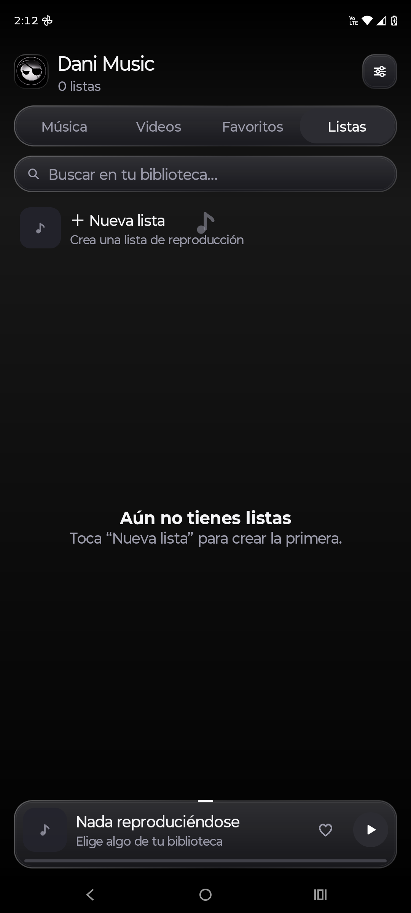

# Dani Music

<p align="center">
  
</p>

<h3 align="center">Tu música. Tu manera.</h3>

<p align="center">
  Reproductor multimedia <strong>local</strong> para Android: tu biblioteca del teléfono,
  un asistente que funciona sin internet, personalización profunda y herramientas
  pensadas para escuchar y organizar sin cuentas ni nube.
</p>

<p align="center">
  <a href="https://github.com/GabryYR/Dani-Musica-Local/releases/latest"><strong>Descargar</strong></a>
  ·
  <a href="https://gabryyr.github.io/Dani-Musica-Local/">Sitio web</a>
  ·
  <a href="https://gabryyr.github.io/Dani-Musica-Local/privacidad-dani-music.html">Privacidad</a>
  ·
  <a href="https://github.com/GabryYR/Dani-Musica-Local/issues">Reportar un problema</a>
</p>

---

## Descripción

**Dani Music** es un proyecto independiente de aplicación Android centrado en la música y el vídeo que ya tienes en el dispositivo.

No requiere cuenta, no sube tu biblioteca a un servidor y el asistente **Dani** interpreta órdenes en el propio teléfono (español o inglés según el idioma del sistema), sin modelos en la nube.

La interfaz usa un lenguaje visual propio (formas “squircle”, marcas de dial, acentos personalizables) y se adapta al rendimiento del equipo.

---

## Características

### Reproducción
- **Música local** desde la biblioteca del teléfono (MediaStore).
- **Vídeo** integrado, con gestos de brillo/volumen, velocidad y **Picture-in-Picture**.
- **Segundo plano** con notificación y controles (servicio de reproducción).
- Cola, aleatorio, repetición (una / todo / nada).
- Velocidad de reproducción configurable.
- Temporizador de apagado (sleep timer).

### Biblioteca y organización
- Listado por título, artista o recientes.
- **Favoritos** y **listas de reproducción** locales.
- Contadores de reproducción y posición recordada (audio y vídeo, según ajustes).
- Filtro de duración mínima (oculta audios muy cortos).

### Asistente Dani (local, sin internet)
- Órdenes en **español e inglés** (“pon algo de Queen”, “play my favorites”, “what’s playing?”…).
- Control del reproductor: pausa, siguiente, favoritos, volumen, velocidad, temporizador, etc.
- Charla ligera, recomendaciones sobre tu propia biblioteca y estados de ánimo (entrenar, estudiar, relajarte…).
- Disponible en el panel lateral de la app y en la **burbuja flotante** (sobre otras apps).

### Letras
- Archivos **`.lrc`** junto a la canción o importados a mano.
- Búsqueda en internet **opcional** (desactivada por defecto) mediante [lrclib.net](https://lrclib.net), solo si la activas en Ajustes.

### Personalización
- Temas oscuro, **AMOLED** y claro.
- Amplia paleta de **colores de acento** (y acento dinámico desde la portada, opcional).
- Imagen de fondo personalizada con atenuado.
- Escala de texto y nivel de animaciones (automático / ligero / medio / máximo; premium añade un nivel extra).
- Efectos visuales propios (aurora Premium, cristal sobre fondo, etc.).

### Otras funciones
- **Burbuja flotante** del asistente (permiso de superposición).
- Splash de arranque acorde al tema.
- Ajustes Premium locales (crossfade, loudness, skip intro/outro, etc.), activados con código en el dispositivo.

> Las características pueden variar según la versión instalada.

---

## Capturas de pantalla

<p align="center">
  
  
  
</p>

<p align="center">
  <sub>Reproductor · Ajustes · Listas</sub>
</p>

---

## Descarga

Versiones publicadas y última build en GitHub Releases:

<p align="center">
  <a href="https://github.com/GabryYR/Dani-Musica-Local/releases/latest">
    <strong>Descargar la última versión de Dani Music</strong>
  </a>
</p>

También puedes revisar el historial de versiones en las publicaciones del repositorio.

---

## Privacidad (resumen)

- Biblioteca, favoritos, listas, historial y ajustes: **solo en el dispositivo**.
- Asistente **sin internet** y sin envío de mensajes a servicios de IA.
- Internet solo si activas la búsqueda de letras; entonces se consulta lrclib.net con título/artista/duración.
- Sin cuentas, sin publicidad integrada y sin analytics de terceros en el código actual.

Política completa: [Política de privacidad](https://gabryyr.github.io/Dani-Musica-Local/privacidad-dani-music.html)  
(Si aún no está publicada en el sitio, usa el archivo HTML del proyecto.)

---

## Información técnica

| Propiedad | Información |
|-----------|-------------|
| Nombre | Dani Music |
| Plataforma | Android |
| Lenguaje | Kotlin |
| Interfaz | Vistas personalizadas (Canvas / layouts); dependencias Compose disponibles en el módulo |
| Diseño | Lenguaje visual propio + Material base en tema de sistema |
| `minSdk` | 23 (Android 6.0) |
| `targetSdk` / `compileSdk` | 36 |
| Versión | 1.0 |
| Paquete | `com.dani.music` |

---

## Estructura del proyecto (orientativa)

```
app/src/main/kotlin/com/dani/music/
├── MainActivity.kt          # Entrada, biblioteca, permisos, splash
├── MusicService.kt          # Reproducción en segundo plano
├── PlayerUi.kt              # Controles del reproductor
├── VideoActivity.kt         # Vídeo + PiP
├── Assistant.kt             # Parseo de órdenes (ES/EN)
├── AssistantRunner.kt       # Ejecución sobre el servicio
├── AssistantPanel.kt        # UI del chat
├── AssistantDrawer.kt       # Panel lateral
├── Bubble.kt                # Burbuja flotante (overlay)
├── Lyrics.kt                # Letras locales y opcionales online
├── ThemeManager.kt          # Temas, acentos, fondo
├── SettingsSheet.kt         # Ajustes
├── QueueSheet.kt            # Cola
├── Lang.kt                  # tr(es, en)
├── Splash.kt                # Pantalla de carga
├── Style.kt / Widgets.kt    # Componentes visuales propios
└── …
```

La estructura exacta puede cambiar conforme evolucione el desarrollo.

---

## Desarrollo

1. Clona el repositorio.
2. Ábrelo en Android Studio (o un entorno compatible con Android / Gradle).
3. Espera a la sincronización del proyecto.
4. Conecta un dispositivo o emulador (API 23+).
5. Ejecuta la variante `debug` o genera un APK/AAB de prueba.

```bash
git clone https://github.com/GabryYR/Dani-Musica-Local.git
cd Dani-Musica-Local
```

> Si el módulo usa un layout de build distinto al estándar de Android Studio, sigue las instrucciones del propio repositorio o de `module.toml`.

---

## Reportar problemas

Abre una incidencia en:  
[github.com/GabryYR/Dani-Musica-Local/issues](https://github.com/GabryYR/Dani-Musica-Local/issues)

Incluye, si puedes:

- Descripción del error  
- Pasos para reproducirlo  
- Versión de la app  
- Modelo y versión de Android  
- Capturas o un vídeo corto  

---

## Aviso

Dani Music es un **proyecto independiente**. Los nombres y marcas de terceros mencionados pertenecen a sus respectivos propietarios. El servicio de letras opcional es proporcionado por [lrclib.net](https://lrclib.net) bajo sus propias condiciones.

---

## Autor y enlaces

**Dani Music** — desarrollado como proyecto independiente para Android.

- Repositorio: [GabryYR/Dani-Musica-Local](https://github.com/GabryYR/Dani-Musica-Local)
- Sitio: [gabryyr.github.io/Dani-Musica-Local](https://gabryyr.github.io/Dani-Musica-Local/)
- Releases: [GitHub Releases](https://github.com/GabryYR/Dani-Musica-Local/releases)
- Privacidad: [Política de privacidad](https://gabryyr.github.io/Dani-Musica-Local/privacidad-dani-music.html)

---

<p align="center">
  <strong>Dani Music</strong><br>
  Una experiencia musical a tu manera · local, personalizable, sin cuentas.
</p>
