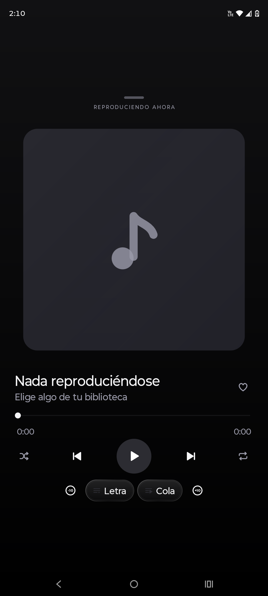
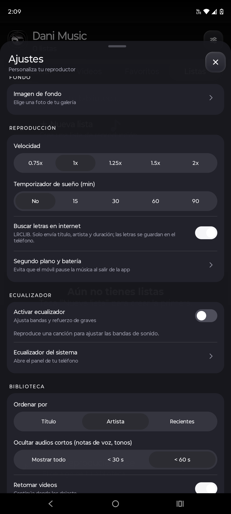

Dani Music

  

<h3 align="center">A local music experience for Android.</h3>

  Reproducción local, personalización y herramientas integradas en una sola aplicación.

  <a href="https://github.com/GabryYR/Dani-Musica-Local/releases/latest">Descargar</a>
  ·
  <a href="https://gabryyr.github.io/Dani-Musica-Local/">Sitio oficial</a>
  ·
  <a href="https://github.com/GabryYR/Dani-Musica-Local/issues">Reportar un problema</a>

---

Descripción

Dani Music es una aplicación Android enfocada en la reproducción de contenido multimedia local.

El proyecto combina un reproductor de música, reproducción de vídeo, herramientas de organización, personalización visual y un asistente integrado.

Su objetivo es ofrecer una experiencia multimedia cómoda, personalizable y centrada en el contenido del dispositivo.

Características

Reproducción multimedia

- Reproducción de archivos de audio locales.
- Reproducción de vídeos.
- Controles de reproducción.
- Servicio de reproducción en segundo plano.
- Controles multimedia mediante notificaciones.
- Compatibilidad con imagen en imagen para vídeo.

Biblioteca y organización

- Interfaz de biblioteca multimedia.
- Listas y cola de reproducción.
- Gestión de favoritos.
- Acceso a contenido multimedia del dispositivo.

Asistente Dani

- Asistente integrado en la aplicación.
- Panel y menú propios.
- Burbuja flotante.
- Servicio para mantener la burbuja disponible.

Letras y conectividad

- Herramientas para consultar letras.
- Búsqueda online opcional de letras.
- Conexión a Internet utilizada para las funciones que la necesitan.

Personalización

- Administración de temas.
- Colores de acento personalizables.
- Efectos visuales.
- Interfaz adaptable al rendimiento del dispositivo.
- Funciones visuales Aurora y Premium.

Capturas de pantalla

Reproductor

Ajustes

Listas

Información técnica

Propiedad| Valor
Nombre| Dani Music
Plataforma| Android
Lenguaje| Kotlin
Interfaz| Jetpack Compose
Namespace| com.dani.music
Compile SDK| 36
Target SDK| 36
Minimum SDK| 23
Version Code| 1
Version Name| 1.0
Distribución| APK

Tecnologías

- Kotlin
- Android SDK
- Jetpack Compose
- Material 3
- AndroidX Activity Compose
- Android Media APIs

Requisitos

- Dispositivo Android compatible.
- Android 6.0 o superior.
- Espacio de almacenamiento disponible.
- Permisos multimedia para acceder a los archivos del dispositivo.

Algunas funciones requieren permisos adicionales, como notificaciones, visualización sobre otras aplicaciones o acceso a Internet.

Instalación

1. Abre la sección de Releases.
2. Descarga el APK disponible.
3. Abre el archivo descargado.
4. Autoriza la instalación desde esa fuente si Android lo solicita.
5. Completa la instalación.

Descargas

Última versión disponible:

"Descargar Dani Music desde GitHub Releases" (https://github.com/GabryYR/Dani-Musica-Local/releases/latest)

Estructura del proyecto

Dani-Musica-Local/
├── app/
│   └── src/
│       └── main/
│           ├── kotlin/com/dani/music/
│           │   ├── Assistant.kt
│           │   ├── AssistantDrawer.kt
│           │   ├── AssistantPanel.kt
│           │   ├── AssistantRunner.kt
│           │   ├── Aurora.kt
│           │   ├── Bubble.kt
│           │   ├── Core.kt
│           │   ├── Lyrics.kt
│           │   ├── MainActivity.kt
│           │   ├── MusicService.kt
│           │   ├── PlayerUi.kt
│           │   ├── Premium.kt
│           │   ├── SettingsSheet.kt
│           │   ├── ThemeManager.kt
│           │   └── VideoActivity.kt
│           ├── res/
│           └── AndroidManifest.xml
├── README.md
├── CHANGELOG.md
├── CONTRIBUTING.md
├── index.html
├── logo-dani.png
├── reproductor.png
├── ajustes.png
└── listas.png

Desarrollo

El proyecto se encuentra en desarrollo. Las características pueden evolucionar entre versiones.

Para informar de errores o sugerir mejoras, utiliza la sección Issues del repositorio.

Desarrollador

GabryYR

Proyecto Dani Music para Android.

---

  Dani Music
   
  Developed by GabryYR

